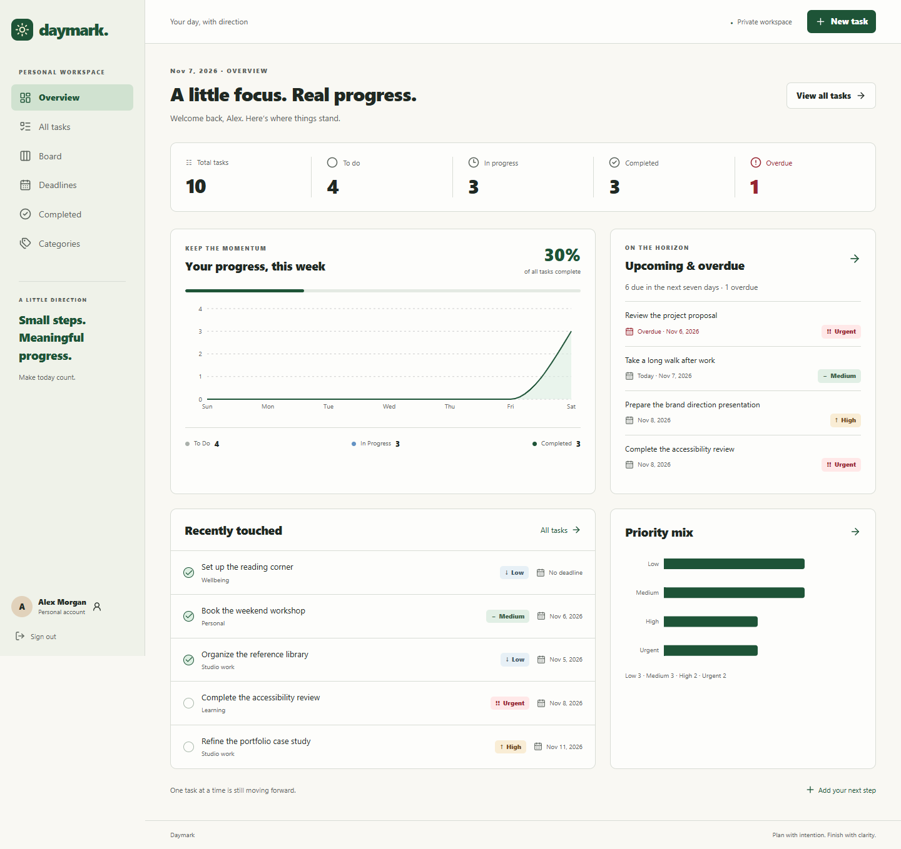
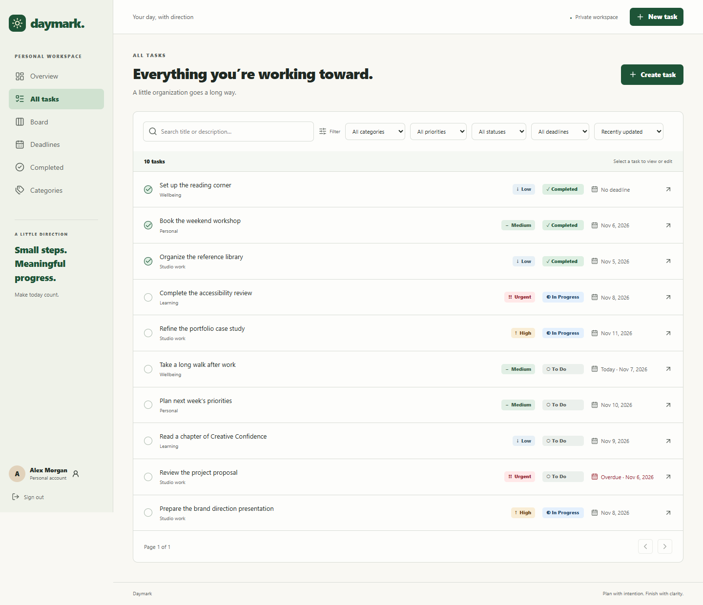
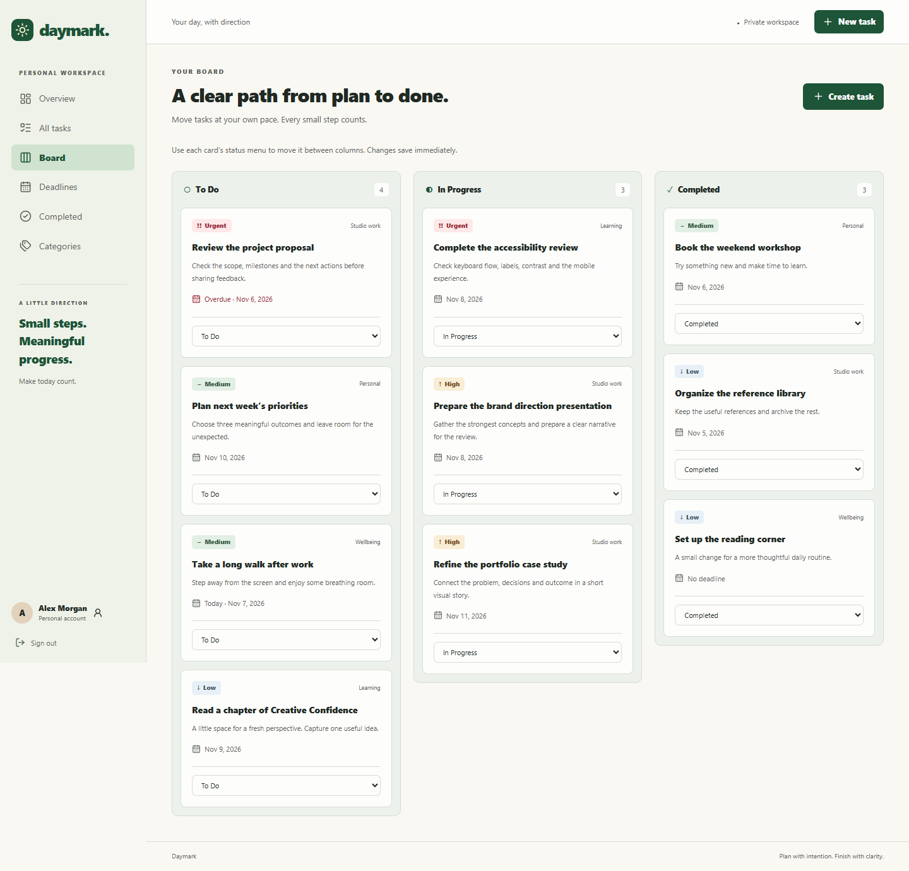

# Daymark · Your day, with direction

A private personal productivity workspace built for **Auspify Technologies Software Development Internship, Task 6**. Plan work, organize priorities, track progress and keep deadlines visible in an original responsive React application backed by ASP.NET Core and PostgreSQL.

[Repository](https://github.com/Jaclyn25/task-management-app) · [Validation workflow](https://github.com/Jaclyn25/task-management-app/actions/workflows/ci.yml) · [API guide](docs/api.md) · [Submission summary](submission/PROJECT-SUMMARY.md)



## Run locally with Docker

Requires Docker Desktop with Linux containers and PowerShell. From this existing repository:

```powershell
pwsh ./scripts/init-env.ps1
docker compose up --build --detach --wait --wait-timeout 180
docker compose ps
```

Open **[Daymark at localhost:18084](http://127.0.0.1:18084)** and create an account. No default password is committed. The initialization script generates a random local database secret in ignored `.env` and preserves existing configuration.

The independent `daymark` project uses PostgreSQL loopback port **54334** and its own database and session-key volumes. The API is internal. Existing Library (18080), Inventory (18081) and Examination (18082) services are unaffected. `docker compose down` preserves volumes. This project has no public deployment or automatic internship submission.

For Linux/macOS, copy `.env.example` to `.env` and set a strong random secret before starting Compose. [Detailed setup and troubleshooting](docs/setup.md).

## Official Task 6 requirements

| Requirement | Implemented workflow |
| --- | --- |
| Task creation, editing and deletion | Validated task forms, detail view, confirmation before deletion, server CRUD and stale-edit protection |
| Categorization and prioritization | Private categories with counts; Low/Medium/High/Urgent; badges, filters, sorting and real distributions |
| Status tracking | To Do, In Progress, Completed; completion timestamps, reopening, counts and completion percentage |
| Due dates and deadline management | Optional start/due dates, date ordering, account-local end-of-day boundaries, overdue/upcoming filters and summaries |
| Progress dashboard | Real owned data, status/priority distributions, recent tasks, deadlines and seven-day completion chart |

The corrected Task 6 requirements define this application. The mismatched examination workflow is intentionally not used.

## Workspace features

- **Private accounts:** registration, login/logout, Identity password hashing, eight-hour sessions, lockout, CSRF protection, rate limits and editable profile/timezone.
- **Tasks:** unique identifiers, descriptions, categories, four priorities, three statuses, date-only start/due dates, UTC record timestamps, detail/edit pages and safe deletion.
- **Find your work:** literal case-insensitive title/description search; category, priority, status and deadline filters; five sort modes; stable server pagination.
- **Categories:** create, rename and delete; trimmed case-insensitive unique names per owner; counts; safe removal preserves tasks as uncategorized.
- **Deadlines:** today, next seven days, overdue and undated views. Completed tasks never appear as currently overdue.
- **Dashboard:** account-scoped totals, status counts, overdue/upcoming counts, completion percentage, recent work, priority bars, status legend and daily completions.
- **Kanban:** three independently paginated columns, priority/category/deadline cards and accessible status menus. Changes persist and version conflicts surface clearly.
- **Interface:** restrained warm/pine visual system, responsive sidebar, route-based editors, semantic navigation, visible focus, native confirmation dialogs, empty/loading/error states and success feedback.

| Task list | Board |
| --- | --- |
|  |  |

[Login](docs/screenshots/login.png) · [Create task](docs/screenshots/task-creation.png) · [Edit task](docs/screenshots/task-editing.png) · [Categories](docs/screenshots/categories.png) · [Deadlines](docs/screenshots/deadlines.png) · [Mobile](docs/screenshots/mobile.png)

Screenshots capture the real application with fictional API-created records. `scripts/capture.mjs` reproduces demo data and images; generated credentials stay only in ignored `.local/demo-account.json`.

## Technology

| Layer | Stack |
| --- | --- |
| API | ASP.NET Core 10, C#, EF Core 10, Npgsql, ASP.NET Core Identity, OpenAPI, JSON structured logging |
| Database | PostgreSQL 17, committed EF migrations, indexes, FK/check/unique constraints, transactions and optimistic concurrency |
| Client | React 19, TypeScript 5.9, Vite 7, Tailwind CSS 4, React Router 7 |
| Data and forms | TanStack Query 5, React Hook Form 7, Zod 4 |
| Charts | Recharts 3 with textual summaries |
| Tests | xUnit, real PostgreSQL integration tests, Vitest/RTL and Playwright Chromium |
| Delivery | Docker Compose, Nginx, GitHub Actions and reproducible source packaging |

Exact dependency versions are in project files and `frontend/package-lock.json`. Native development supports .NET SDK 10 and Node 22.13+ or Node 24 LTS. CI uses Node 24; Docker uses supported Node 22 LTS.

## Architecture and security

```text
React workspace
    ↓ same-origin /api requests + cookie/CSRF pair
Vite proxy / Nginx
    ↓
Authorized thin controllers
    ↓
Scoped task, category and dashboard services
    ↓
EF Core + PostgreSQL + ASP.NET Core Identity
```

Owner IDs come exclusively from the authenticated session. Every private query/mutation enforces ownership; foreign and absent records both return 404. Task/category updates carry UUID version tokens. EF compares the original version so competing edits cannot silently overwrite each other. Category deletion is transactional; dashboard reads use a consistent snapshot.

Deadlines use PostgreSQL `date`. Recorded instants use UTC. An open task becomes overdue only after its due date ends in the profile's timezone. Updating timezone changes classification, not the saved date. Reopening a completed task clears its completion instant.

**Local delivery only.** Published ports bind to loopback, API runs as non-root and secrets are excluded from source/build contexts. The loopback HTTP configuration uses SameSite=Strict and HttpOnly cookies; Secure follows the incoming request. Public hosting would require HTTPS, trusted proxy configuration and an operational security review. [Security notes](docs/security.md), [authentication guide](docs/authentication.md).

## Development and verification

```powershell
docker compose up -d db
docker compose exec -T db createdb -U daymark daymark_test
dotnet tool restore
pwsh ./scripts/start-api.ps1
```

In another terminal, run `npm ci` and `npm run dev` inside `frontend`. Native web is [localhost:5177](http://127.0.0.1:5177), API health is [localhost:5084/api/health](http://127.0.0.1:5084/api/health).

```powershell
pwsh ./scripts/test-backend.ps1
pwsh ./scripts/audit-backend.ps1
cd frontend
npm run typecheck
npm run lint
npm run format:check
npm test
npm run build
npx playwright install chromium
npm run test:e2e
npm audit --audit-level=moderate
```

Stop a native Release API process before rebuilding the same configuration on Windows. Browser tests against Docker use `E2E_URL=http://127.0.0.1:18084`. Backend tests require a separate real PostgreSQL database; they do not silently fall back to an in-memory provider. [Test guide](docs/testing.md) · [Executed results](submission/TEST-RESULTS.md).

GitHub Actions validates backend/PostgreSQL tests, dependency audits, TypeScript, lint/format, frontend tests/build, Chromium flows and Docker health/smoke checks. There are no deployment or portal-submission jobs. [PR delivery record](submission/DELIVERY.md).

## Repository layout

```text
backend/Daymark.Api/     Controllers, DTO contracts, services, Identity/data and migrations
tests/Daymark.Tests/     Real PostgreSQL/API and boundary/security tests
frontend/src/           React workspace, design tokens and interaction tests
frontend/e2e/           Playwright critical user journeys
scripts/                Local configuration, startup, audit, smoke, capture and packaging
docs/                   Architecture, setup, API, database, authentication and screenshots
submission/             Internship summary, delivery record and verification evidence
```

## Source package and limitations

Run `pwsh ./scripts/package-source.ps1` from a clean committed checkout. It uses `git archive HEAD`, verifies excluded paths, and writes a source ZIP, SHA-256 sidecar and manifest under ignored `.local/`. It excludes secrets, dependencies, database contents, build outputs and Git metadata. [Source packaging instructions](submission/DELIVERY.md).

This is a personal workspace, with no team sharing, email recovery, MFA, recurring tasks or drag-and-drop. Board status menus support keyboard/touch use. Search uses ordinary PostgreSQL substring queries; large datasets may benefit from measured indexing improvements. Current-state completion history is shown; an immutable activity log is not implemented.
