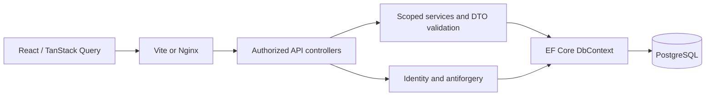

# Architecture

Daymark is an independent ASP.NET Core 10 and React workspace. Thin controllers delegate business rules to scoped services. EF Core and PostgreSQL provide relational persistence. Authentication uses Identity and same-origin cookies with antiforgery tokens. No public deployment is configured.

The API has no unnecessary repository abstraction. TaskService owns validation, query composition, lifecycle and version checks. CategoryService owns normalized naming and transactional deletion. DashboardService reads a repeatable snapshot. Controllers derive the owner from claims and translate HTTP payloads to service calls. DomainExceptionHandler returns consistent safe Problem Details.

React Router owns navigation, TanStack Query owns server data and invalidation, and React Hook Form/Zod validate editor fields before submission. The server independently validates all writes. No user-private records are persisted in browser localStorage. Status changes use versioned full task writes; board moves wait for the server rather than presenting unconfirmed optimistic changes.

The UI uses shared badges, task rows, errors/loading/empty feedback and native confirmation dialogs. Each board column paginates independently. Dashboard charts have textual data summaries. Native selects provide reliable keyboard and touch status changes without a drag-only interaction.

Task updates compare a client version and EF's original concurrency token. Completion timestamps follow status exactly. Category deletion updates affected task versions and detaches category links within one transaction; the FK also handles deletion safely. User ownership is filtered in every resource service. UTC instants and account-local date-only deadlines have separate meanings.

Docker has three services and two private volumes. A small API command-line health probe uses its normal HTTP health endpoint without adding shell HTTP clients to the runtime. The API runs non-root; Nginx serves the built SPA and proxies same-origin requests. BuildKit caches improve repeated builds and are not required source inputs. Production containers apply committed migrations during startup and preserve session encryption keys across restarts.

Feature branches start from synchronized main. Pull requests are merged after their checks pass. The initial commit bootstrapped an empty existing repository.
